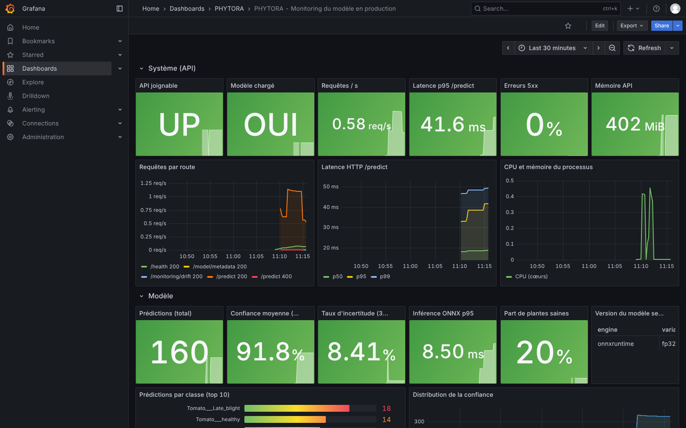
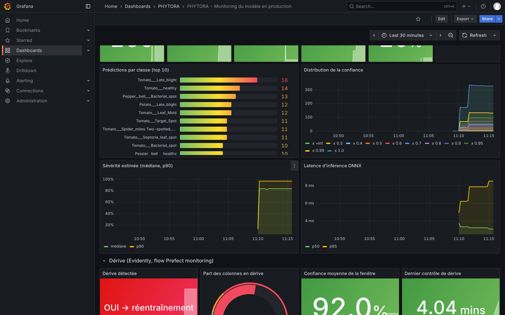
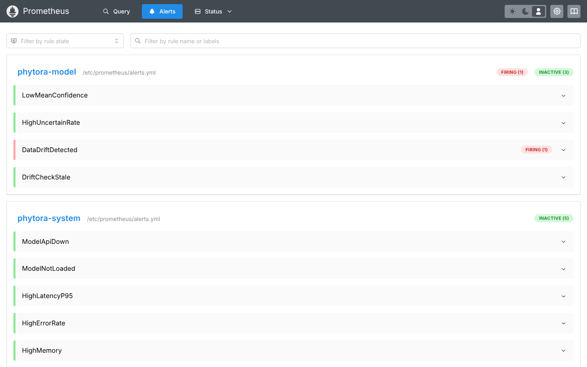
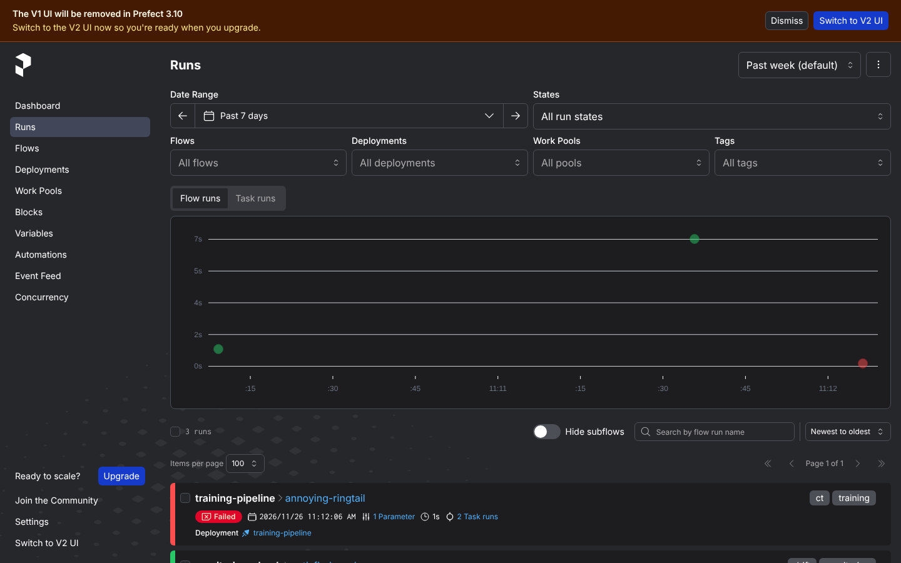

# Rapport de monitoring et de performance du modèle

## 1. Ce qui est mesuré

### Niveau système (Prometheus, endpoint `GET /metrics` de l'API)
| Métrique | Type | Usage |
|---|---|---|
| `phytora_http_requests_total{method,route,status}` | counter | trafic, taux d'erreurs 5xx |
| `phytora_http_request_duration_seconds{route}` | histogram | latence p50 / p95 / p99 |
| `process_cpu_seconds_total`, `process_resident_memory_bytes` | process | ressources de l'API |
| `up{job="phytora-api"}` | Prometheus | disponibilité |

### Niveau modèle
| Métrique | Type | Usage |
|---|---|---|
| `phytora_inference_duration_seconds` | histogram | temps de calcul ONNX seul |
| `phytora_predictions_total{class_id,healthy}` | counter | répartition des classes prédites |
| `phytora_prediction_confidence` | histogram | confiance moyenne et distribution |
| `phytora_uncertain_predictions_total` | counter | taux de prédictions incertaines |
| `phytora_severity_percent` | histogram | sévérité estimée |
| `phytora_model_info{version,engine,variant}` | info | version servie |
| `phytora_data_drift_share`, `phytora_drift_detected`, `phytora_drift_check_age_seconds` | gauges | résultat du dernier contrôle de dérive |

### Journal structuré
Chaque prédiction produit une ligne JSON (stdout et volume `prediction-logs`, fichier `predictions.jsonl`). Elle contient l'horodatage, l'identifiant de requête, la version du modèle, la classe, la confiance, la marge top-1/top-2, l'incertitude, la sévérité, les latences et **les descripteurs de l'image** : taille, luminosité, contraste, saturation, part de vert, netteté et couverture de la feuille. Ce journal est l'entrée de la détection de dérive. Aucune image n'est stockée.

## 2. Détection de dérive (Evidently, flow Prefect `monitoring-check`)
- **Référence** : `reports/monitoring/reference.csv` (étape DVC `reference`), soit 500 images de **validation** passées dans le modèle exporté, exactement comme en production.
- **Fenêtre courante** : les 500 dernières prédictions réelles (les prédictions de démonstration sont exclues), avec un minimum de 30.
- **Dérive des données** : test K-S par descripteur numérique et χ² sur la classe prédite (Evidently `DataDriftPreset`). Il y a dérive du jeu de données si au moins 30 % des colonnes dérivent.
- **Dérive des prédictions** (indicateur de dérive de concept, car les vraies étiquettes n'arrivent que via les retours « diagnostic correct ? ») : chute de la confiance moyenne de plus de 10 points, ou hausse du taux d'incertitude de plus de 15 points.
- **Sorties** : `drift_report.html` (rapport Evidently), `drift_summary.json` (lu par l'API et exporté vers Prometheus), `drift_history.jsonl`.
- **Réaction** : alerte `DataDriftDetected`, ligne dans `reports/monitoring/alerts.jsonl`, webhook optionnel, puis **déclenchement du réentraînement** (flow `training-pipeline`, raison `drift`).

## 3. Alertes (Prometheus, `configs/prometheus/alerts.yml`)
| Alerte | Condition | Gravité |
|---|---|---|
| ModelApiDown | `/metrics` injoignable pendant 1 min | critique |
| ModelNotLoaded | aucun modèle chargé | critique |
| HighLatencyP95 | p95 de `/predict` > 1 s pendant 5 min | avertissement |
| HighErrorRate | plus de 5 % de réponses 5xx pendant 5 min | avertissement |
| HighMemory | plus de 3 Go de mémoire | avertissement |
| LowMeanConfidence | confiance moyenne < 70 % sur 30 min | avertissement |
| HighUncertainRate | plus de 30 % de prédictions incertaines | avertissement |
| DataDriftDetected | dernier contrôle en dérive | avertissement |
| DriftCheckStale | aucun contrôle de dérive depuis 2 jours | info |

## 4. Résultats de la démonstration (26/11/2026, pile `docker compose` complète)
Scénario : 40 photos PlantVillage normales, puis 120 photos assombries (luminosité × 0,35) pour simuler des photos prises au champ à la tombée du jour. Le flow `monitoring-check` a ensuite été lancé depuis Prefect.

| Indicateur | Valeur |
|---|---|
| Prédictions surveillées | 160 (référence : 450 images) |
| Statut | **dérive détectée** |
| Part des colonnes en dérive | 54,6 % (seuil 30 %) |
| Colonnes en dérive | luminosité, contraste, netteté, couverture de la feuille, confiance, classe prédite |
| Confiance moyenne | 98,1 % (référence) → 92,0 % (production) |
| Latence p95 de `/predict` (Grafana) | 41,7 ms ; inférence ONNX p95 : 8,5 ms |
| Alerte Prometheus | `DataDriftDetected` à l'état **firing** au bout d'une minute |

Avant l'injection des photos sombres, le même contrôle donnait **0 % de colonnes en dérive** (statut `ok`).

Performances du modèle servi (MobileNetV3-Small, jeu de test PlantVillage) : exactitude 98,8 %, F1 macro 98,3 %, ONNX FP32 en 1,5 ms par image sur CPU.

## 5. Procédure de réentraînement et de mise à jour
1. Déclencheur : dérive détectée (automatique), nouvelles données (`ingest-new-data`), planification hebdomadaire, ou bouton **Run** dans Prefect.
2. `training-pipeline` : données validées, entraînement, évaluation, puis **quality gate** (F1 macro test ≥ `pipeline.min_test_macro_f1`). En cas d'échec, **rollback** des artefacts et alerte.
3. `export` : modèle ONNX enregistré dans MLflow (alias `staging`), promu `production` **seulement s'il bat la version en production**.
4. Nouvelle référence de dérive (`reference`), `dvc push`, puis `POST /admin/reload` : l'API charge le nouveau modèle sans interruption, et garde l'ancien si le chargement échoue.
5. Vérification : `phytora_model_info` change de version dans Grafana, et la confiance et la dérive reviennent à la normale.

**Limite** : la référence fournie avec `models/legacy` a été calculée sur un échantillon de 15 classes. Après `dvc pull` du dataset complet, lancez `dvc repro reference` pour une référence couvrant les 38 classes.
